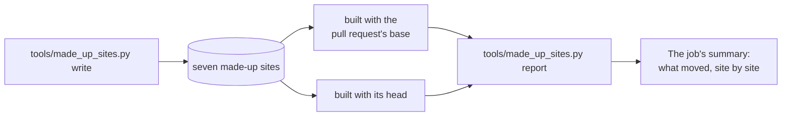

# Contributing to Domus

Thanks for wanting to help. Bug reports, ideas and pull requests are all welcome: the issue templates ask for what
helps, and a pull request's template asks what changes and how you checked it. Everyone taking part follows the
[code of conduct](CODE_OF_CONDUCT.md), and security problems go privately, as [SECURITY.md](SECURITY.md) says.

This guide is for changing Domus itself. To model a place with it, read [README.md](README.md), and agents read
[AGENTS.md](AGENTS.md). [ARCHITECTURE.md](ARCHITECTURE.md) explains how the package is put together.

## The one rule: no real property

This repository is meant to be read by anyone. Nothing about a real property ever goes in it: not an address, a name, a plan, a
photo, a video frame, a measurement, a coordinate, a feature's id or anything else that could point at one. That
covers code, comments, tests, docs, examples, pictures, commit messages, issues and pull requests.

- **Use the made-up sites.** `domus demo` writes one, and `tools/made_up_sites.py` writes six more. They're all in the
  sea, so none is anyone's house. Examples use their made-up ids, frame names and numbers.
- **Keep real sites out of git.** In a copy of this repo a property lives in `site/` or `sites/<name>/`, which git
  ignores, or in a folder or private repository of its own. A test fails if git tracks anything its ignore rules leave
  out, so `git add -f` can't sneak a site in.
- **Pictures come from the made-up sites, with no metadata.** `domus shots` writes PNGs with nothing but the image. A
  picture made another way has its metadata stripped before it's committed, and is checked.
- **Check for your own words before you push.** Keep a list of words that would identify a real site you work on (its
  street, suburb, people's names, its ids) in a file outside the repo, one to a line, and search the tracked files for
  them:

  ```sh
  git grep -n -i -w -F -f ~/private-words.txt
  ```

  It should find nothing. The maintainers run a check like this over every tracked file before anything is pushed.
- **Graduating a site's tool** into common means rewriting it for any site, with its numbers as settings, tested on a
  made-up site. The site's own data, names and history stay behind. A changelog note can say a feature grew in a real
  site's tool, without saying which.

## Set up

You'll need [uv](https://docs.astral.sh/uv/), which installs the Python this repo names (3.14) for you, and
[Node.js](https://nodejs.org/), which the tests use to check the viewer's drawing and scanning code.

```sh
uv sync --all-extras
uv run playwright install chromium      # once on each machine, for domus shots and its tests (--with-deps on Linux)
```

`--all-extras` adds the optional parts: reading PDFs (`plans`), IFC models (`ifc`) and Playwright (`shots`). Without
Playwright's Chromium, the tests that take pictures skip themselves.

Then try the made-up demo, to see everything working:

```sh
uv run domus demo sites/demo
uv run domus --site sites/demo build
uv run domus --site sites/demo serve
```

## Before you push

```sh
uv run pytest -q
uv run ruff check .
uv run lint-imports
```

All three must pass. CI runs them on every pull request and push to `main`, with more:

| CI job | What it does |
|---|---|
| `test` | `ruff`, `lint-imports` and `pytest`, after `uv sync --frozen --all-extras` |
| `image` | Builds the container image, serves the demo from it read-only as Unraid would, and builds a site inside it |
| `made-up-sites` | Pull requests only: builds the made-up sites with the pull request's base and its head, and says what moved |
| CodeQL | Weekly, a security scan of the Python and the JavaScript |

Dependabot proposes updates to the GitHub Actions, the Docker base image and the Python dependencies (in `uv.lock`)
once a month.

## How the code is laid out

`src/domus` is laid out by what each part does: the site's grid and geometry, the model's parts, the wall options, the
build, exports to other software, the checks, video and scans, documents, importers that bring a place in, the site
folder and the public API, and on top of them the app (`domus/app/`): the command line, the server and the viewer. [ARCHITECTURE.md](ARCHITECTURE.md) has the table, and it's
where to look first, as the layout is still settling.

Import rules, in `[tool.importlinter]` in `pyproject.toml` and checked by `uv run lint-imports`, keep four promises:

- **The server uses the standard library only**, and runs builds and jobs in processes of their own, so it stays light
  and a slow build never blocks it.
- **The model's pure parts read no site and know nothing of the app.** The house, the walls and their looks, the small
  features, the plants, the drains, the ground's triangulation, the mesh helpers and the working out of a wall option
  are functions of what they're handed. The build is the workflow that reads the site and hands it to them.
- **The pure layers read no site.** `geo` (the grid maths, rasters, GeoJSON, meshes and fits), the model's pure
  parts and the working out of a wall option are handed what they need: a site's grid is made from its settings, and a
  raster is read from the file and grid it's given. Only the names kept for site code reach a site, and only those.
- **The app sits on top.** Nothing else in Domus imports `domus.app` (the command line, the server and the viewer),
  and within it only the command line imports the server.

A few more rules the code keeps:

- **A problem a person can put right raises `DomusError`**, with a message that says what, never `SystemExit`. The
  command line shows just the message.
- **Every text file is read and written as UTF-8, by name.** A test finds any read or write that doesn't say so, since
  Windows' default isn't UTF-8.
- **Every layer but the ground and the boundary is optional.** Code copes with a site that has none of the others.
- **Every part that reads a site is handed its Site:** its folder, output, settings, format and grid, as the
  function's first argument. What a part reads of a site is kept with that site, so one process can hold several. The
  command line and the server read `DOMUS_SITE` once and hand the site down, and a job in a process of its own gets the
  site's folder. Nothing reads the current site: the older names that do, kept for site code, are deprecated.
- **The viewer is one page and loads nothing from other hosts.** New libraries go in its `vendor` folder. Its
  `index.html` is a page body with no doctype or head: the server adds the skeleton. Scripts drive it through
  `window.siteViewer` (`setCamera` and `drawn`).
- **The build is a pure function of the site folder:** the same folder and the same Domus build the same model on any
  machine, and the build never goes to the internet.

## Tests

The tests run on the made-up demo site, written into a temporary folder and built once for the whole run. They set
`DOMUS_SITE` to it, `DOMUS_STRICT_SETTINGS=1`, which makes reading a setting the schema doesn't declare, or reading one
with another default than the schema's, an error, and `DOMUS_STRICT_SITE=1`, which makes a part of Domus called
without its site an error. Fixtures in `tests/conftest.py` give a test the demo's folder (`site`), the demo as a Site to
hand to what's tested (`project`), its built model (`built`), and another folder's Site (`at_site`), made current for
the test as site code would see it.

Some tests guard the repository itself, so expect them to speak up:

- the settings tables in [docs/site-format.md](docs/site-format.md) say what the schema says;
- every text read and write names UTF-8;
- the examples in [`site/`](site/README.md) run on the demo, and their tests pass;
- git tracks nothing its ignore rules leave out;
- [docs/shots.md](docs/shots.md)'s example spec fits the demo.

Write new tests against the made-up sites. When none has what a test needs, add it to the richer one in
`tools/made_up_sites.py` (a test's own small site in a temporary folder is fine too). Never a real site.

## Proving a change left the model alone

Most changes to the build shouldn't move a model at all, and that's provable. Build the same site before and after
your change, into folders of their own, and compare:

```sh
DOMUS_SITE=sites/demo DOMUS_OUTPUT=/tmp/before uv run domus build --fresh
# ... make your change ...
DOMUS_SITE=sites/demo DOMUS_OUTPUT=/tmp/after uv run domus build --fresh
python tools/compare_builds.py /tmp/before /tmp/after
```

It compares every value in `model.json` and `summary.json` and every other file by its hash. When nothing moved it
says so (on the demo, `15 of 15 files identical; 0 differences`); when something did, it lists what and exits 1.
`--site` names a site and clears `DOMUS_OUTPUT`, so use `DOMUS_SITE` as above to build somewhere else. `--fresh` takes
nothing from the build cache.

CI does this for every pull request, on the made-up sites:



| Site | What it is |
|---|---|
| `demo` | What `domus demo` writes: a sloping lot, a small house, a block wall, a drain, trees, a fence and two wall options |
| `richer` | The demo with more of what real sites have: house parts, levels along the drain, a sewer at an assumed depth, a right of way listed before the lot, trees over the drive with the paving under them painted into the photo, a third option with a paved terrace, and an option in walls of a named block that say how they're built |
| `abroad` | The demo moved onto the British National Grid, rasters and all. Its build must match the demo's within 1.5 mm |
| `format1`, `format2`, `format3` | The demo as a site in each older format, with what the next format changed. They stay as they are for good |
| `left` | The demo with its options' frame run the other way along the same boundary, so the lot lies on the frame line's left (`[frame] side = "left"`), and its options drawn to stand where the demo's do |

A change that shouldn't move a model shows "nothing" for every site. The job fails only when the head can't build a
site the base could, or builds the abroad site other than the demo. To run the same locally, write the sites, copy
each into a `base-<site>` and a `head-<site>` folder, build each with `uv run domus --site ... build` from a checkout
of each side (a `git worktree` of `main` makes a good base), record `ok` or `failed` in `<side>-<site>.status`, and run
`python tools/made_up_sites.py report DIR`. The `made-up-sites` job in `.github/workflows/ci.yml` is the exact recipe.

A change that's meant to move a model says what moved in its pull request, and why.

## Settings

Every setting a site can hold is declared once in Domus's settings schema, with its default and a line of help, and
the code reads settings through it (ARCHITECTURE.md says where the schema lives). A site that leaves a key out reads
its default, and a key Domus doesn't know gets a warning naming the nearest one it does. A site's own notes go under
`[local]`, which Domus never reads.

To add a setting:

1. Declare it in the schema, with its default (or as required, or worked out) and its help.
2. Read it through the settings, leaving the default to the schema.
3. Run `uv run python tools/settings_doc.py`, which rewrites the tables in docs/site-format.md between its
   `<!-- settings: ... -->` markers, and commit the result. `--check` says whether they're current, and a test runs it.

A setting that grows out of a site's own tool keeps the number the tool used as its default, so no site's build moves.

## Site formats and migrations

A site says its format in `[domus] format` in `data/site.toml` (4 today). Every Domus reads older sites: each change of
format comes with a migration that reads the old way in memory, for good, so an old site builds unchanged without
anyone touching it. `domus site upgrade` writes the migrations into a site's files when its owner is ready
(`--dry-run` first says what would change, and copies of what it changes are kept in the site's `.domus/`).

When a change alters how a site says something:

1. Bump the format that `domus new` and `domus create` write.
2. Add the migration, in memory, from the previous format.
3. Teach `domus site upgrade` to write it, keeping comments.
4. Add a made-up site in the previous format to `tools/made_up_sites.py`, with what your change alters, beside
   `format1` to `format3`. Those never change, so CI keeps proving every older format still builds as it did.
5. Add a "For site projects" note to the changelog.

`[domus] requires` lets a site say the oldest Domus that builds it.

## The public API's promise

Site tools, a site's own tests and agents use `domus.api` and `domus.testing` ([docs/api.md](docs/api.md)). What they
offer keeps working from one release to the next: changing or removing any of it takes a deprecation warning in an
earlier release and a "For site projects" note in the changelog. Everything else in the package is internal and can
change in any release. When modules move, their old import paths keep working as the same modules, so a site's tools
written before don't break.

## Docs and the changelog

Write for a person: plain English, short sentences, the words they'd use, and say what they'll see. Every claim is true
of the code: run what you describe on a made-up site before you write it down. Commands and `domus.api` are what docs
describe; internal module paths can move. Examples use the made-up sites.

Every change gets a line in [CHANGELOG.md](CHANGELOG.md), under `## Unreleased` at the top (add that heading if a
release has just taken it):

- One bullet per change, saying what changed and what it means for someone using Domus.
- **For site projects:** starts a bullet that changes what a site's files, settings or tools must do, and says what to
  do about it.
- Say it the way the docs do. Link the doc that has the detail.
- When a feature grew in a real site's own tool, say so without naming the site, and say how you showed the common one
  reproduces it.

## Pull requests

- One topic each. A pull request that does two things is two pull requests.
- Fill in the template: **What changes** and **How you checked it**, ticking the checks and the no-real-property line.
- Show the viewer with pictures of a made-up site when the viewer changes.
- Say what moved in the made-up sites' builds, or that nothing did.

## How a release goes

Releases are the maintainers' call. Versions are calendar versions, `YEAR.MONTH.COUNT`: `2026.11.0` is the first
release of November 2026 and `2026.11.1` the next, by UTC, with no zero padding.

1. Make sure the notes under `## Unreleased` in CHANGELOG.md say everything the release brings.
2. `python tools/release.py` works out the version, dates the notes, sets the package's version, locks, commits and
   tags. It stops if the notes are empty or anything else is uncommitted.
3. `git push origin HEAD vYEAR.MONTH.COUNT`, as it prints.

The tag starts the release workflow: it checks the tag matches the code's version and runs the tests again, publishes
the image to `ghcr.io/populii/domus` as `YEAR.MONTH.COUNT`, `YEAR.MONTH` and `latest` (with an SBOM and provenance,
and signed while the repository is public), and makes a GitHub release from that version's section of the changelog.
