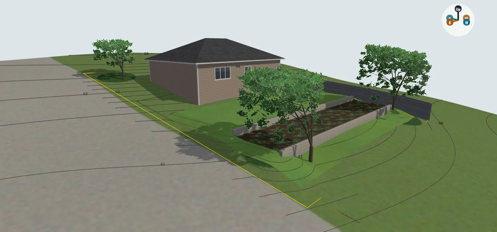
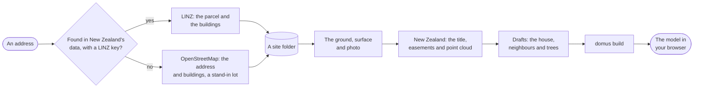
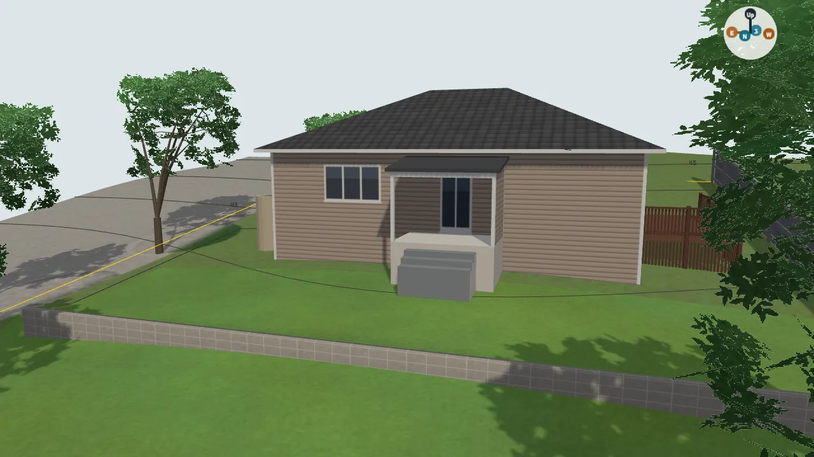
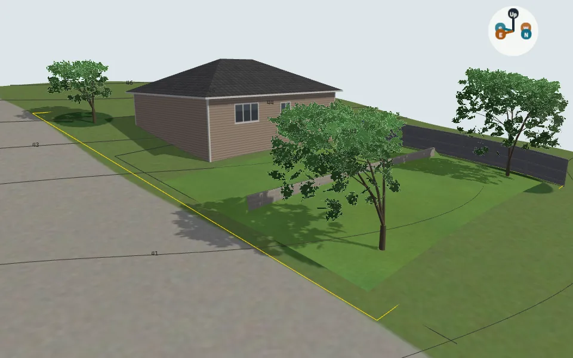
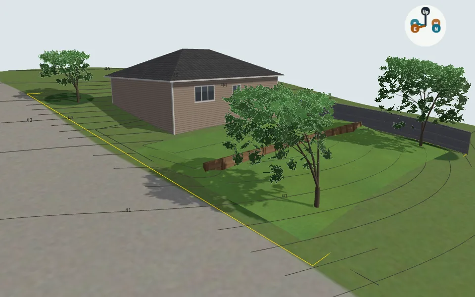
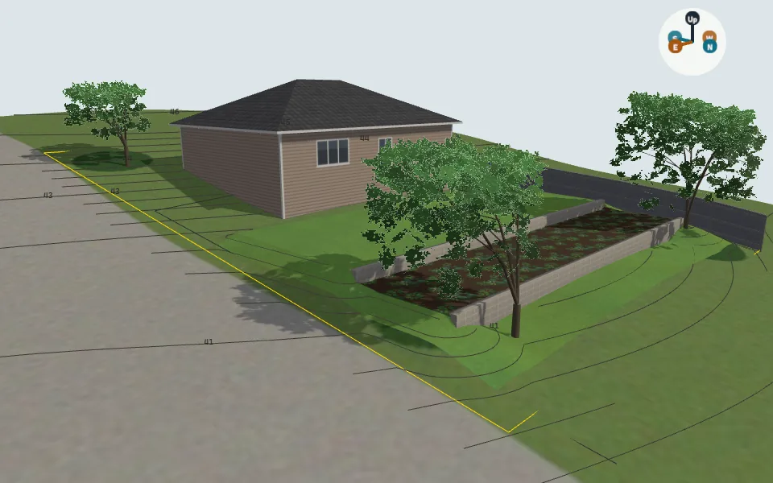
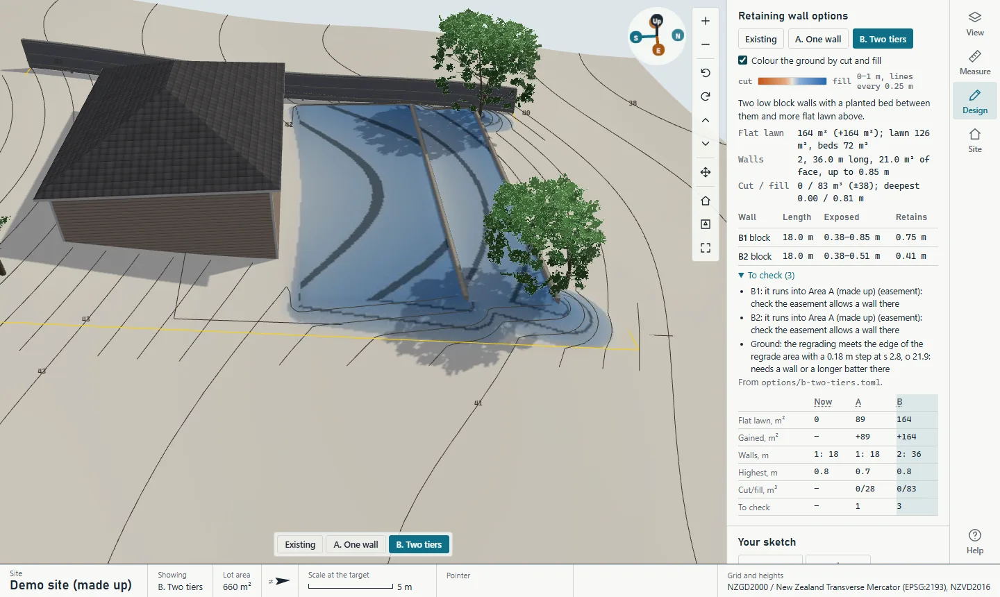

<p align="center">
  <picture>
    <source media="(prefers-color-scheme: dark)" srcset="docs/images/domus-logo-dark.svg">
    
  </picture>
</p>

<h1 align="center">Domus</h1>

<p align="center">
  <strong>Type in an address. Get a 3D model of the place in your browser.</strong><br>
  Then try retaining walls on it, and see what each one does to the ground, before anyone draws anything.
</p>

<p align="center">
  <a href="#try-it">Try it</a> ·
  <a href="#how-a-model-comes-about">How it works</a> ·
  <a href="#what-you-can-do-with-it">What it does</a> ·
  <a href="AGENTS.md">For agents</a> ·
  <a href="CONTRIBUTING.md">Contributing</a> ·
  <a href="#the-docs">The docs</a>
</p>



<p align="center"><sub>The made-up demo site with scheme B: two low block walls and a planted bed. Every picture of a site in this repo is of a made-up one. None is a real place.</sub></p>

Domus grew out of a very ordinary problem: a sloping section, a tired retaining wall, and no good way to picture what
could replace it. Drawings cost money, and it's hard to argue about a wall you can't see. It turns out New Zealand
publishes a remarkable amount of open data about its land, so Domus pulls that together into a model you can walk
around, measure and try ideas on. Then it keeps getting better as you add what you know: a walk round the place with
your phone, a few tape measurements, the plans in the council's file.

It runs on your own machine or home server, and your site's files stay in a folder you control.

> [!WARNING]
> **Domus is a planning aid, not a survey.** Its numbers come from public LiDAR, your phone and your tape measure. It
> helps you ask better questions. An engineer, a surveyor and your council still get the last word.

## How a model comes about

<picture>
  <source media="(prefers-color-scheme: dark)" srcset="docs/images/story-dark.svg">
  
</picture>

A model starts rough and gets better with everything you feed it. Here's the whole journey, one step at a time.

### 1. An address

`domus create "12 Example Street, Christchurch"` finds the place: the address, the legal parcel and the buildings round
it. It starts a **site folder** for the property, an ordinary folder of text files and pictures you can read, edit and
back up. If the address could be in more than one town, Domus asks which you meant.

<details>
<summary><b>What <code>domus create</code> does, step by step</b></summary>
<br>



- In New Zealand, the ground, the surface and the aerial photo come from LINZ's open LiDAR and imagery. Elsewhere the
  ground comes from the Copernicus 30 m ground model, and there's no photo.
- With a LINZ key, Domus also adds the lot's title and the easements near it, and in New Zealand it tries for the
  LiDAR's point cloud, to fit the roof better.
- The house is drafted from its outline, with its height and roof fitted to the LiDAR (a hip, a gable or a skillion).
  Neighbouring buildings become plain blocks, and trees come from the LiDAR's canopy and the photo.
- Stopped part way? Run the same command again and it carries on.

</details>

### 2. Public data

<picture>
  <source media="(prefers-color-scheme: dark)" srcset="docs/images/public-data-dark.svg">
  
</picture>

New Zealand is lucky here. LINZ publishes 1 m LiDAR for much of the country: a **ground model** (the bare earth), a
**surface model** (the tops of roofs and trees), and sharp recent **aerial photos**, all free. Domus takes the newest of
each over your site, just the patch it needs, and notes what it used and how old it is.

Anywhere else, the start is rougher: OpenStreetMap's buildings, a 30 m ground model, and a square stand-in for the lot
until you draw the real one. Bring your own LiDAR and photos, on any grid, and the model is as good as New Zealand's.

### 3. A phone walk

LiDAR is great on open ground and pretty useless under a tree. It also can't know about anything built or dug since the
survey. A slow walk round the property with your phone fills those gaps, and it's the single most useful thing you can
do yourself, today, for free.

<picture>
  <source media="(prefers-color-scheme: dark)" srcset="docs/images/video-walk-dark.svg">
  
</picture>

Domus suggests a route for your site: round the lot's edge, a detour to each place the LiDAR sees worst (under the trees,
along steep banks), then a loop round the house. Show it on the model, walk it, and Domus turns the video into a cloud
of 3D points on your site's grid, to measure against and fit the model to.

<picture>
  <source media="(prefers-color-scheme: dark)" srcset="docs/images/viewer-walk-dark.webp">
  
</picture>

<p align="center"><sub>The viewer's <b>Improve this model</b> panel, with the suggested walk drawn on the made-up demo.</sub></p>

Open your site on your phone, over https, and the same panel has a **Scan with this phone** button: a guided page that
films the walk and uploads it for you. [docs/video.md](docs/video.md) has the whole recipe, including what to do when a clip falls
apart, which they do.

### 4. Measurements

A tape and a level are still the most accurate tools you own. A handful of measured heights, on the walls and the
ground that matter, ties everything else down. They go in the site's layers as plain GeoJSON, with a note of where each
number came from and how far to trust it.

### 5. The model

Everything comes together in one page in your browser: the ground with the photo draped over it, the house, existing
walls, drains at their depth, fences, trees, lawns and beds, and the point clouds from your walks. Every part says where
it came from and how sure it is, so you always know what you're looking at.



<p align="center"><sub>The house on a richer made-up site: a porch with its steps, a tank, a deck with a balustrade, and an old block wall.</sub></p>

### 6. Schemes side by side

Now the fun part. A retaining wall scheme is a small text file: where each wall goes, what it's made of, and the level
of each lawn or bed it holds. Or just sketch one on the model in the viewer and press **Make it an option**. Domus works
out the ground each scheme makes, and you flick between them.

| The ground now | A. One low wall | B. Two tiers |
|:---:|:---:|:---:|
|  |  |  |

<details>
<summary><b>What a scheme looks like as a file</b></summary>
<br>

Scheme A on the made-up demo, `options/a-one-wall.toml` in its site folder. Positions are metres along one boundary
of the lot (`s`) and in from it (`o`), so you can read them off a tape:

```toml
name = "A. One low wall"
short = "A. One wall"
description = "A single timber wall holds a level lawn."
steps = 0
keep_existing = []

[[walls]]
id = "A1"
name = "Lawn wall"
material = "timber"
line_so = [[8.0, 2.0], [8.0, 20.0]]

[[terraces]]
id = "lawn"
name = "Lawn"
kind = "lawn"
level = 42.0
at_so = [11.0, 11.0]
fall = "1:40"
fall_to = "north"
batter = 2.5
polygon_so = [[8.0, 2.0], [8.0, 20.0], [14.0, 20.0], [14.0, 2.0]]
```

Walls can be timber, block, segmental, gabion, crib, stone or concrete, and a named block is laid out course by course
at its real size. A scheme can be based on another and restyled, to compare the same layout in different walls.
[docs/options.md](docs/options.md) has all of it.

To take a scheme into other software, `domus export option-a.glb --option a-one-wall` writes it as glTF for Blender and
3D viewers, and `.ifc` as IFC for a designer's software, with each wall's numbers. [docs/export.md](docs/export.md) says
what each holds.

</details>

### 7. Cut and fill

<picture>
  <source media="(prefers-color-scheme: dark)" srcset="docs/images/cut-and-fill-dark.svg">
  
</picture>

For every scheme, Domus works out how much ground moves (cut and fill, with a range from the LiDAR's tolerance), how
high each wall stands, and how much flat lawn you gain. Tick **Colour the ground by cut and fill** to see where.

<picture>
  <source media="(prefers-color-scheme: dark)" srcset="docs/images/viewer-design-dark.webp">
  
</picture>

Here's how the made-up demo's two schemes come out, as its build works them out:

| | The ground now | A. One low wall | B. Two tiers |
|---|---:|---:|---:|
| Flat lawn | 0 m² | 89 m² | 164 m² |
| Walls | one old wall, 18 m | one timber wall, 18 m | two block walls, 36 m |
| Highest wall face | 0.75 m | 0.68 m | 0.85 m |
| Cut / fill | | 0.3 / 28 m³ (±19) | 0 / 83 m³ (±38) |
| Things to check | | 1 | 3 |

### 8. Checks

Domus flags what to look at before anyone digs: a wall running into an easement, the cover left over a drain after a
cut, a wall crossing a drain, a footing close to a post, pole, survey mark or inspection lid, ground lowered next to the
house or raised against it, steps that are too steep, and regrading that ends in a step at the edge of the area you let
it change. On the demo, both schemes run into a made-up easement, and scheme B's regrading meets the edge of its area
with an 18 cm step.

It checks the model itself too: things floating or buried, spikes and holes in the ground, a roof that doesn't fit the
LiDAR, clouds that are tilted or off the ground. A check that fails is a question to answer, not a box to tick.

## What you can do with it

<table>
<tr>
<td width="50%" valign="top">

**Look around**

- Orbit, pan and zoom, or jump to the overview, a plan and views you save.
- Drape the ground with the aerial photo, a scanned plan or plain relief.
- Turn the ground see-through to look at drains at their depth.
- Exaggerate the vertical scale to read gentle slopes.

</td>
<td width="50%" valign="top">

**Measure**

- Distances, paths, areas and heights.
- A ground profile along any line you draw.
- Each layer's note says how far to trust a measurement on it.
- Go to a coordinate, and read a point's grid position and height.

</td>
</tr>
<tr>
<td valign="top">

**Design**

- Sketch walls and level areas right on the model.
- Snap to the boundary, the house, existing walls and survey marks; type a length, or `3.2@45` for a bearing too.
- See the ground a sketch makes as you draw, with its cut and fill, and save it as an option.
- Flick between schemes with <kbd>[</kbd> and <kbd>]</kbd>.

</td>
<td valign="top">

**Share and keep**

- `domus shots` saves pictures of each scheme from the views you choose.
- `domus export` writes the site, or a scheme, as glTF for Blender and 3D viewers, or as IFC for a designer's software,
  with each wall's numbers.
- Sketches save as you go, with your notes, and copy out as text.
- A site folder can be a git repository of its own: `domus create` writes a `.gitignore` that leaves out what Domus makes again.
- Back up one folder and you've backed up everything.

</td>
</tr>
</table>

## Try it

### The demo, in two minutes

The quickest way is Docker:

```sh
docker compose -f deploy/compose.yml up -d
```

Open <http://localhost:8765>. With an empty site folder it asks for your address. Want a look first? `/demo` shows the
made-up site, so you can poke at everything without any data of your own.

> [!NOTE]
> The image and this repo are private for now, so this needs access to them. Otherwise, build the image yourself with
> `docker build -t ghcr.io/populii/domus:latest .`.

Prefer no Docker? You'll need [uv](https://docs.astral.sh/uv/), which sorts out Python for you:

```sh
uv sync
uv run domus demo sites/demo
uv run domus --site sites/demo build
uv run domus --site sites/demo serve
```

Then open <http://127.0.0.1:8765>. The demo builds in a few seconds.

### Your own place

```sh
uv run domus create "12 Example Street, Christchurch" site
uv run domus --site site serve
```

That's it: a few minutes later you're walking round a model of your place. In a copy of this repo, `site/` is the place
for it, because git ignores everything you add there.

<details>
<summary><b>Get a free LINZ key first (New Zealand)</b></summary>
<br>

For the real boundary and building outlines, make a free API key at [data.linz.govt.nz](https://data.linz.govt.nz) and
set it as `DOMUS_LINZ_KEY`.

Without a key Domus still works, with two catches: it looks your address up in OpenStreetMap instead, so the address
goes to OpenStreetMap's public servers, and OpenStreetMap has no parcels, so your lot starts as a 24 m square round the
address. Domus says so when this happens. The LiDAR and photo still come from LINZ.

</details>

<details>
<summary><b>Outside New Zealand</b></summary>
<br>

Domus finds the address and the buildings round it in OpenStreetMap, puts the site on its UTM zone, and fetches the
ground from the Copernicus ground model, which covers the world's land at 30 m. That gives you the lie of the land
rather than the detail LINZ's 1 m LiDAR does, and the lot is a stand-in square until you draw the real one. Bring your
own ground model and photo if you have them: [docs/new-site.md](docs/new-site.md) says how.

</details>

<details>
<summary><b>Already have a boundary?</b></summary>
<br>

Start from your own, as GeoJSON, and add things yourself:

```sh
uv run domus new site --name "My place" --boundary lot.geojson
uv run domus --site site fetch
uv run domus --site site build
uv run domus --site site serve
```

[docs/new-site.md](docs/new-site.md) walks through it, and [docs/site-format.md](docs/site-format.md) lists every file
and setting.

</details>

### Host it at home

Domus is a single container that keeps everything in one `/site` folder. Set `DOMUS_SITES` and one container holds many
sites, each in its own folder, with a list page and a box for new addresses.
[docs/self-hosting.md](docs/self-hosting.md) covers Docker, Unraid (there's a template in `deploy/unraid/`), upgrades
and putting a login in front.

> [!IMPORTANT]
> **There's no login built in.** Anyone who can reach the port can see the model, change sketches, add sites, upload
> videos and start builds, so keep it on your own network or behind a login proxy. If you reach it by a host name, list
> that name in `DOMUS_ALLOWED_HOSTS`. [SECURITY.md](SECURITY.md) has more, and how to report a problem.

## Make the model better

The first model is a sketch. The viewer's **Improve this model** panel, in the Site tab, lists what would help for your
site and ticks things off as their files appear. Here they are, with the two you can do yourself today first:

| Add this | What it gets you | How |
|---|---|---|
| A video walk | Under trees, wall faces, anything changed since the survey | `domus video`: [docs/video.md](docs/video.md) |
| Tape and level measurements | Accurate walls and ground | `walls-existing.geojson`, `ground-fixes.geojson` |
| Title and survey plan | The surveyed boundary, not a guide | `boundary.geojson` |
| LIM report, consent history | Drainage plans, hazards, what was consented | Keep them in `sources/raw/` and read off what you need |
| Building and site plans | True dimensions and levels | `domus prep plan-georef`, `plan-trace` |
| Drainage records | Cover over pipes, and walls crossing them | `services.geojson` |
| A phone LiDAR scan | Walls and banks in true metres, close up | `domus scan`: [docs/phone-lidar.md](docs/phone-lidar.md) |
| Photos | Real walls and fences in place of drawn ones | `domus prep house-textures`, `feature-textures` |
| A designer's IFC model | The building in place, with its levels | `domus prep ifc` |

The documents often take days and a fee. The walk and the tape measure you can do this afternoon, so start there.
[docs/from-documents.md](docs/from-documents.md) covers plans, IFC models and photos.

## Turn it around

Here's the made-up demo with scheme B as a small 3D model: the ground the scheme makes, its two walls and the house, as
Domus works them out, on a coarse grid to keep it small. Drag to turn it. (The real thing, in the viewer, has the
photo, the plants and everything else.)

```stl
solid made-up-demo
facet normal -0.07 0.18 0.98
outer loop
vertex 0 0 4.27
vertex 4 0 4.53
vertex 4 4 3.82
endloop
endfacet
facet normal -0.07 0.18 0.98
outer loop
vertex 0 0 4.27
vertex 4 4 3.82
vertex 0 4 3.56
endloop
endfacet
facet normal -0.05 0.18 0.98
outer loop
vertex 4 0 4.53
vertex 9 0 4.78
vertex 9 4 4.07
endloop
endfacet
facet normal -0.05 0.18 0.98
outer loop
vertex 4 0 4.53
vertex 9 4 4.07
vertex 4 4 3.82
endloop
endfacet
facet normal -0.02 0.18 0.98
outer loop
vertex 9 0 4.78
vertex 12.5 0 4.84
vertex 12.5 4 4.12
endloop
endfacet
facet normal -0.02 0.18 0.98
outer loop
vertex 9 0 4.78
vertex 12.5 4 4.12
vertex 9 4 4.07
endloop
endfacet
facet normal 0.02 0.18 0.98
outer loop
vertex 12.5 0 4.84
vertex 15.85 0 4.78
vertex 15.85 4 4.07
endloop
endfacet
facet normal 0.02 0.18 0.98
outer loop
vertex 12.5 0 4.84
vertex 15.85 4 4.07
vertex 12.5 4 4.12
endloop
endfacet
facet normal 0.03 0.18 0.98
outer loop
vertex 15.85 0 4.78
vertex 16.15 0 4.77
vertex 16.15 4 4.06
endloop
endfacet
facet normal 0.03 0.18 0.98
outer loop
vertex 15.85 0 4.78
vertex 16.15 4 4.06
vertex 15.85 4 4.07
endloop
endfacet
facet normal 0.04 0.18 0.98
outer loop
vertex 16.15 0 4.77
vertex 19.85 0 4.61
vertex 19.85 4 3.89
endloop
endfacet
facet normal 0.04 0.18 0.98
outer loop
vertex 16.15 0 4.77
vertex 19.85 4 3.89
vertex 16.15 4 4.06
endloop
endfacet
facet normal 0.06 0.18 0.98
outer loop
vertex 19.85 0 4.61
vertex 20.15 0 4.59
vertex 20.15 4 3.88
endloop
endfacet
facet normal 0.06 0.18 0.98
outer loop
vertex 19.85 0 4.61
vertex 20.15 4 3.88
vertex 19.85 4 3.89
endloop
endfacet
facet normal 0.06 0.18 0.98
outer loop
vertex 20.15 0 4.59
vertex 23 0 4.41
vertex 23 4 3.69
endloop
endfacet
facet normal 0.06 0.18 0.98
outer loop
vertex 20.15 0 4.59
vertex 23 4 3.69
vertex 20.15 4 3.88
endloop
endfacet
facet normal 0.07 0.18 0.98
outer loop
vertex 23 0 4.41
vertex 25 0 4.27
vertex 25 4 3.56
endloop
endfacet
facet normal 0.07 0.18 0.98
outer loop
vertex 23 0 4.41
vertex 25 4 3.56
vertex 23 4 3.69
endloop
endfacet
facet normal -0.07 0.18 0.98
outer loop
vertex 0 4 3.56
vertex 4 4 3.82
vertex 4 7.9 3.09
endloop
endfacet
facet normal -0.07 0.18 0.98
outer loop
vertex 0 4 3.56
vertex 4 7.9 3.09
vertex 0 7.9 2.83
endloop
endfacet
facet normal -0.05 0.18 0.98
outer loop
vertex 4 4 3.82
vertex 9 4 4.07
vertex 9 7.9 3.34
endloop
endfacet
facet normal -0.05 0.18 0.98
outer loop
vertex 4 4 3.82
vertex 9 7.9 3.34
vertex 4 7.9 3.09
endloop
endfacet
facet normal -0.02 0.18 0.98
outer loop
vertex 9 4 4.07
vertex 12.5 4 4.12
vertex 12.5 7.9 3.39
endloop
endfacet
facet normal -0.02 0.18 0.98
outer loop
vertex 9 4 4.07
vertex 12.5 7.9 3.39
vertex 9 7.9 3.34
endloop
endfacet
facet normal 0.02 0.18 0.98
outer loop
vertex 12.5 4 4.12
vertex 15.85 4 4.07
vertex 15.85 7.9 3.34
endloop
endfacet
facet normal 0.02 0.18 0.98
outer loop
vertex 12.5 4 4.12
vertex 15.85 7.9 3.34
vertex 12.5 7.9 3.39
endloop
endfacet
facet normal 0.03 0.18 0.98
outer loop
vertex 15.85 4 4.07
vertex 16.15 4 4.06
vertex 16.15 7.9 3.33
endloop
endfacet
facet normal 0.03 0.18 0.98
outer loop
vertex 15.85 4 4.07
vertex 16.15 7.9 3.33
vertex 15.85 7.9 3.34
endloop
endfacet
facet normal 0.04 0.18 0.98
outer loop
vertex 16.15 4 4.06
vertex 19.85 4 3.89
vertex 19.85 7.9 3.16
endloop
endfacet
facet normal 0.04 0.18 0.98
outer loop
vertex 16.15 4 4.06
vertex 19.85 7.9 3.16
vertex 16.15 7.9 3.33
endloop
endfacet
facet normal 0.06 0.18 0.98
outer loop
vertex 19.85 4 3.89
vertex 20.15 4 3.88
vertex 20.15 7.9 3.15
endloop
endfacet
facet normal 0.06 0.18 0.98
outer loop
vertex 19.85 4 3.89
vertex 20.15 7.9 3.15
vertex 19.85 7.9 3.16
endloop
endfacet
facet normal 0.06 0.18 0.98
outer loop
vertex 20.15 4 3.88
vertex 23 4 3.69
vertex 23 7.9 2.96
endloop
endfacet
facet normal 0.06 0.18 0.98
outer loop
vertex 20.15 4 3.88
vertex 23 7.9 2.96
vertex 20.15 7.9 3.15
endloop
endfacet
facet normal 0.07 0.18 0.98
outer loop
vertex 23 4 3.69
vertex 25 4 3.56
vertex 25 7.9 2.83
endloop
endfacet
facet normal 0.07 0.18 0.98
outer loop
vertex 23 4 3.69
vertex 25 7.9 2.83
vertex 23 7.9 2.96
endloop
endfacet
facet normal -0.07 0.17 0.98
outer loop
vertex 0 7.9 2.83
vertex 4 7.9 3.09
vertex 4 8.1 3.06
endloop
endfacet
facet normal -0.07 0.17 0.98
outer loop
vertex 0 7.9 2.83
vertex 4 8.1 3.06
vertex 0 8.1 2.79
endloop
endfacet
facet normal -0.05 0.17 0.98
outer loop
vertex 4 7.9 3.09
vertex 9 7.9 3.34
vertex 9 8.1 3.3
endloop
endfacet
facet normal -0.05 0.17 0.98
outer loop
vertex 4 7.9 3.09
vertex 9 8.1 3.3
vertex 4 8.1 3.06
endloop
endfacet
facet normal -0.02 0.17 0.98
outer loop
vertex 9 7.9 3.34
vertex 12.5 7.9 3.39
vertex 12.5 8.1 3.36
endloop
endfacet
facet normal -0.02 0.17 0.98
outer loop
vertex 9 7.9 3.34
vertex 12.5 8.1 3.36
vertex 9 8.1 3.3
endloop
endfacet
facet normal 0.02 0.17 0.98
outer loop
vertex 12.5 7.9 3.39
vertex 15.85 7.9 3.34
vertex 15.85 8.1 3.31
endloop
endfacet
facet normal 0.02 0.17 0.98
outer loop
vertex 12.5 7.9 3.39
vertex 15.85 8.1 3.31
vertex 12.5 8.1 3.36
endloop
endfacet
facet normal 0.03 0.17 0.98
outer loop
vertex 15.85 7.9 3.34
vertex 16.15 7.9 3.33
vertex 16.15 8.1 3.3
endloop
endfacet
facet normal 0.03 0.17 0.98
outer loop
vertex 15.85 7.9 3.34
vertex 16.15 8.1 3.3
vertex 15.85 8.1 3.31
endloop
endfacet
facet normal 0.05 0.17 0.98
outer loop
vertex 16.15 7.9 3.33
vertex 19.85 7.9 3.16
vertex 19.85 8.1 3.13
endloop
endfacet
facet normal 0.05 0.17 0.98
outer loop
vertex 16.15 7.9 3.33
vertex 19.85 8.1 3.13
vertex 16.15 8.1 3.3
endloop
endfacet
facet normal 0.06 0.17 0.98
outer loop
vertex 19.85 7.9 3.16
vertex 20.15 7.9 3.15
vertex 20.15 8.1 3.11
endloop
endfacet
facet normal 0.06 0.17 0.98
outer loop
vertex 19.85 7.9 3.16
vertex 20.15 8.1 3.11
vertex 19.85 8.1 3.13
endloop
endfacet
facet normal 0.06 0.17 0.98
outer loop
vertex 20.15 7.9 3.15
vertex 23 7.9 2.96
vertex 23 8.1 2.93
endloop
endfacet
facet normal 0.06 0.17 0.98
outer loop
vertex 20.15 7.9 3.15
vertex 23 8.1 2.93
vertex 20.15 8.1 3.11
endloop
endfacet
facet normal 0.07 0.17 0.98
outer loop
vertex 23 7.9 2.96
vertex 25 7.9 2.83
vertex 25 8.1 2.79
endloop
endfacet
facet normal 0.07 0.17 0.98
outer loop
vertex 23 7.9 2.96
vertex 25 8.1 2.79
vertex 23 8.1 2.93
endloop
endfacet
facet normal -0.07 0.15 0.99
outer loop
vertex 0 8.1 2.79
vertex 4 8.1 3.06
vertex 4 12 2.47
endloop
endfacet
facet normal -0.07 0.15 0.99
outer loop
vertex 0 8.1 2.79
vertex 4 12 2.47
vertex 0 12 2.2
endloop
endfacet
facet normal -0.05 0.15 0.99
outer loop
vertex 4 8.1 3.06
vertex 9 8.1 3.3
vertex 9 12 2.71
endloop
endfacet
facet normal -0.05 0.15 0.99
outer loop
vertex 4 8.1 3.06
vertex 9 12 2.71
vertex 4 12 2.47
endloop
endfacet
facet normal -0.02 0.15 0.99
outer loop
vertex 9 8.1 3.3
vertex 12.5 8.1 3.36
vertex 12.5 12 2.77
endloop
endfacet
facet normal -0.02 0.15 0.99
outer loop
vertex 9 8.1 3.3
vertex 12.5 12 2.77
vertex 9 12 2.71
endloop
endfacet
facet normal 0.02 0.15 0.99
outer loop
vertex 12.5 8.1 3.36
vertex 15.85 8.1 3.31
vertex 15.85 12 2.72
endloop
endfacet
facet normal 0.02 0.15 0.99
outer loop
vertex 12.5 8.1 3.36
vertex 15.85 12 2.72
vertex 12.5 12 2.77
endloop
endfacet
facet normal 0.03 0.15 0.99
outer loop
vertex 15.85 8.1 3.31
vertex 16.15 8.1 3.3
vertex 16.15 12 2.71
endloop
endfacet
facet normal 0.03 0.15 0.99
outer loop
vertex 15.85 8.1 3.31
vertex 16.15 12 2.71
vertex 15.85 12 2.72
endloop
endfacet
facet normal 0.05 0.15 0.99
outer loop
vertex 16.15 8.1 3.3
vertex 19.85 8.1 3.13
vertex 19.85 12 2.54
endloop
endfacet
facet normal 0.05 0.15 0.99
outer loop
vertex 16.15 8.1 3.3
vertex 19.85 12 2.54
vertex 16.15 12 2.71
endloop
endfacet
facet normal 0.06 0.15 0.99
outer loop
vertex 19.85 8.1 3.13
vertex 20.15 8.1 3.11
vertex 20.15 12 2.52
endloop
endfacet
facet normal 0.06 0.15 0.99
outer loop
vertex 19.85 8.1 3.13
vertex 20.15 12 2.52
vertex 19.85 12 2.54
endloop
endfacet
facet normal 0.06 0.15 0.99
outer loop
vertex 20.15 8.1 3.11
vertex 23 8.1 2.93
vertex 23 12 2.34
endloop
endfacet
facet normal 0.06 0.15 0.99
outer loop
vertex 20.15 8.1 3.11
vertex 23 12 2.34
vertex 20.15 12 2.52
endloop
endfacet
facet normal 0.07 0.15 0.99
outer loop
vertex 23 8.1 2.93
vertex 25 8.1 2.79
vertex 25 12 2.2
endloop
endfacet
facet normal 0.07 0.15 0.99
outer loop
vertex 23 8.1 2.93
vertex 25 12 2.2
vertex 23 12 2.34
endloop
endfacet
facet normal -0.07 -0 1
outer loop
vertex 0 12 2.2
vertex 4 12 2.47
vertex 4 17 2.48
endloop
endfacet
facet normal -0.19 0.1 0.98
outer loop
vertex 0 12 2.2
vertex 4 17 2.48
vertex 0 17 1.71
endloop
endfacet
facet normal -0.05 0.05 1
outer loop
vertex 4 12 2.47
vertex 9 12 2.71
vertex 9 17 2.48
endloop
endfacet
facet normal 0 -0 1
outer loop
vertex 4 12 2.47
vertex 9 17 2.48
vertex 4 17 2.48
endloop
endfacet
facet normal -0.02 0.06 1
outer loop
vertex 9 12 2.71
vertex 12.5 12 2.77
vertex 12.5 17 2.48
endloop
endfacet
facet normal 0 0.05 1
outer loop
vertex 9 12 2.71
vertex 12.5 17 2.48
vertex 9 17 2.48
endloop
endfacet
facet normal 0.02 0.05 1
outer loop
vertex 12.5 12 2.77
vertex 15.85 12 2.72
vertex 15.85 17 2.48
endloop
endfacet
facet normal 0 0.06 1
outer loop
vertex 12.5 12 2.77
vertex 15.85 17 2.48
vertex 12.5 17 2.48
endloop
endfacet
facet normal 0.03 0.05 1
outer loop
vertex 15.85 12 2.72
vertex 16.15 12 2.71
vertex 16.15 17 2.48
endloop
endfacet
facet normal 0 0.05 1
outer loop
vertex 15.85 12 2.72
vertex 16.15 17 2.48
vertex 15.85 17 2.48
endloop
endfacet
facet normal 0.05 0.01 1
outer loop
vertex 16.15 12 2.71
vertex 19.85 12 2.54
vertex 19.85 17 2.48
endloop
endfacet
facet normal 0 0.05 1
outer loop
vertex 16.15 12 2.71
vertex 19.85 17 2.48
vertex 16.15 17 2.48
endloop
endfacet
facet normal 0.06 0.01 1
outer loop
vertex 19.85 12 2.54
vertex 20.15 12 2.52
vertex 20.15 17 2.48
endloop
endfacet
facet normal 0 0.01 1
outer loop
vertex 19.85 12 2.54
vertex 20.15 17 2.48
vertex 19.85 17 2.48
endloop
endfacet
facet normal 0.06 0.1 0.99
outer loop
vertex 20.15 12 2.52
vertex 23 12 2.34
vertex 23 17 1.85
endloop
endfacet
facet normal 0.22 0.01 0.98
outer loop
vertex 20.15 12 2.52
vertex 23 17 1.85
vertex 20.15 17 2.48
endloop
endfacet
facet normal 0.07 0.1 0.99
outer loop
vertex 23 12 2.34
vertex 25 12 2.2
vertex 25 17 1.71
endloop
endfacet
facet normal 0.07 0.1 0.99
outer loop
vertex 23 12 2.34
vertex 25 17 1.71
vertex 23 17 1.85
endloop
endfacet
facet normal -0.19 0.1 0.98
outer loop
vertex 0 17 1.71
vertex 4 17 2.48
vertex 4 22 1.98
endloop
endfacet
facet normal -0.17 0.08 0.98
outer loop
vertex 0 17 1.71
vertex 4 22 1.98
vertex 0 22 1.31
endloop
endfacet
facet normal -0 0.1 1
outer loop
vertex 4 17 2.48
vertex 9 17 2.48
vertex 9 22 1.98
endloop
endfacet
facet normal 0 0.1 1
outer loop
vertex 4 17 2.48
vertex 9 22 1.98
vertex 4 22 1.98
endloop
endfacet
facet normal -0 0.1 1
outer loop
vertex 9 17 2.48
vertex 12.5 17 2.48
vertex 12.5 22 1.98
endloop
endfacet
facet normal 0 0.1 1
outer loop
vertex 9 17 2.48
vertex 12.5 22 1.98
vertex 9 22 1.98
endloop
endfacet
facet normal -0 0.1 1
outer loop
vertex 12.5 17 2.48
vertex 15.85 17 2.48
vertex 15.85 22 1.98
endloop
endfacet
facet normal 0 0.1 1
outer loop
vertex 12.5 17 2.48
vertex 15.85 22 1.98
vertex 12.5 22 1.98
endloop
endfacet
facet normal -0 0.1 1
outer loop
vertex 15.85 17 2.48
vertex 16.15 17 2.48
vertex 16.15 22 1.98
endloop
endfacet
facet normal 0 0.1 1
outer loop
vertex 15.85 17 2.48
vertex 16.15 22 1.98
vertex 15.85 22 1.98
endloop
endfacet
facet normal -0 0.1 1
outer loop
vertex 16.15 17 2.48
vertex 19.85 17 2.48
vertex 19.85 22 1.98
endloop
endfacet
facet normal 0 0.1 1
outer loop
vertex 16.15 17 2.48
vertex 19.85 22 1.98
vertex 16.15 22 1.98
endloop
endfacet
facet normal -0 0.1 1
outer loop
vertex 19.85 17 2.48
vertex 20.15 17 2.48
vertex 20.15 22 1.98
endloop
endfacet
facet normal 0 0.1 1
outer loop
vertex 19.85 17 2.48
vertex 20.15 22 1.98
vertex 19.85 22 1.98
endloop
endfacet
facet normal 0.22 0.08 0.97
outer loop
vertex 20.15 17 2.48
vertex 23 17 1.85
vertex 23 22 1.44
endloop
endfacet
facet normal 0.18 0.1 0.98
outer loop
vertex 20.15 17 2.48
vertex 23 22 1.44
vertex 20.15 22 1.98
endloop
endfacet
facet normal 0.07 0.08 0.99
outer loop
vertex 23 17 1.85
vertex 25 17 1.71
vertex 25 22 1.31
endloop
endfacet
facet normal 0.07 0.08 0.99
outer loop
vertex 23 17 1.85
vertex 25 22 1.31
vertex 23 22 1.44
endloop
endfacet
facet normal -0.16 0.16 0.97
outer loop
vertex 0 22 1.31
vertex 4 22 1.98
vertex 4 25.9 1.32
endloop
endfacet
facet normal -0.12 0.12 0.99
outer loop
vertex 0 22 1.31
vertex 4 25.9 1.32
vertex 0 25.9 0.83
endloop
endfacet
facet normal -0 0.16 0.99
outer loop
vertex 4 22 1.98
vertex 9 22 1.98
vertex 9 25.9 1.35
endloop
endfacet
facet normal -0 0.17 0.99
outer loop
vertex 4 22 1.98
vertex 9 25.9 1.35
vertex 4 25.9 1.32
endloop
endfacet
facet normal -0 0.15 0.99
outer loop
vertex 9 22 1.98
vertex 12.5 22 1.98
vertex 12.5 25.9 1.4
endloop
endfacet
facet normal -0.02 0.16 0.99
outer loop
vertex 9 22 1.98
vertex 12.5 25.9 1.4
vertex 9 25.9 1.35
endloop
endfacet
facet normal -0 0.16 0.99
outer loop
vertex 12.5 22 1.98
vertex 15.85 22 1.98
vertex 15.85 25.9 1.35
endloop
endfacet
facet normal 0.02 0.15 0.99
outer loop
vertex 12.5 22 1.98
vertex 15.85 25.9 1.35
vertex 12.5 25.9 1.4
endloop
endfacet
facet normal -0 0.16 0.99
outer loop
vertex 15.85 22 1.98
vertex 16.15 22 1.98
vertex 16.15 25.9 1.34
endloop
endfacet
facet normal 0.03 0.16 0.99
outer loop
vertex 15.85 22 1.98
vertex 16.15 25.9 1.34
vertex 15.85 25.9 1.35
endloop
endfacet
facet normal -0 0.18 0.98
outer loop
vertex 16.15 22 1.98
vertex 19.85 22 1.98
vertex 19.85 25.9 1.29
endloop
endfacet
facet normal 0.01 0.16 0.99
outer loop
vertex 16.15 22 1.98
vertex 19.85 25.9 1.29
vertex 16.15 25.9 1.34
endloop
endfacet
facet normal -0 0.16 0.99
outer loop
vertex 19.85 22 1.98
vertex 20.15 22 1.98
vertex 20.15 25.9 1.36
endloop
endfacet
facet normal -0.23 0.17 0.96
outer loop
vertex 19.85 22 1.98
vertex 20.15 25.9 1.36
vertex 19.85 25.9 1.29
endloop
endfacet
facet normal 0.18 0.12 0.98
outer loop
vertex 20.15 22 1.98
vertex 23 22 1.44
vertex 23 25.9 0.97
endloop
endfacet
facet normal 0.13 0.16 0.98
outer loop
vertex 20.15 22 1.98
vertex 23 25.9 0.97
vertex 20.15 25.9 1.36
endloop
endfacet
facet normal 0.07 0.12 0.99
outer loop
vertex 23 22 1.44
vertex 25 22 1.31
vertex 25 25.9 0.84
endloop
endfacet
facet normal 0.07 0.12 0.99
outer loop
vertex 23 22 1.44
vertex 25 25.9 0.84
vertex 23 25.9 0.97
endloop
endfacet
facet normal -0.12 0.31 0.94
outer loop
vertex 0 25.9 0.83
vertex 4 25.9 1.32
vertex 4 26.1 1.26
endloop
endfacet
facet normal -0.11 0.15 0.98
outer loop
vertex 0 25.9 0.83
vertex 4 26.1 1.26
vertex 0 26.1 0.81
endloop
endfacet
facet normal -0 0.15 0.99
outer loop
vertex 4 25.9 1.32
vertex 9 25.9 1.35
vertex 9 26.1 1.32
endloop
endfacet
facet normal -0.01 0.31 0.95
outer loop
vertex 4 25.9 1.32
vertex 9 26.1 1.32
vertex 4 26.1 1.26
endloop
endfacet
facet normal -0.02 0.15 0.99
outer loop
vertex 9 25.9 1.35
vertex 12.5 25.9 1.4
vertex 12.5 26.1 1.37
endloop
endfacet
facet normal -0.02 0.15 0.99
outer loop
vertex 9 25.9 1.35
vertex 12.5 26.1 1.37
vertex 9 26.1 1.32
endloop
endfacet
facet normal 0.02 0.15 0.99
outer loop
vertex 12.5 25.9 1.4
vertex 15.85 25.9 1.35
vertex 15.85 26.1 1.32
endloop
endfacet
facet normal 0.02 0.15 0.99
outer loop
vertex 12.5 25.9 1.4
vertex 15.85 26.1 1.32
vertex 12.5 26.1 1.37
endloop
endfacet
facet normal 0.03 0.15 0.99
outer loop
vertex 15.85 25.9 1.35
vertex 16.15 25.9 1.34
vertex 16.15 26.1 1.31
endloop
endfacet
facet normal 0.03 0.15 0.99
outer loop
vertex 15.85 25.9 1.35
vertex 16.15 26.1 1.31
vertex 15.85 26.1 1.32
endloop
endfacet
facet normal 0.01 0.3 0.96
outer loop
vertex 16.15 25.9 1.34
vertex 19.85 25.9 1.29
vertex 19.85 26.1 1.22
endloop
endfacet
facet normal 0.02 0.15 0.99
outer loop
vertex 16.15 25.9 1.34
vertex 19.85 26.1 1.22
vertex 16.15 26.1 1.31
endloop
endfacet
facet normal -0.22 0.32 0.92
outer loop
vertex 19.85 25.9 1.29
vertex 20.15 25.9 1.36
vertex 20.15 26.1 1.29
endloop
endfacet
facet normal -0.21 0.29 0.93
outer loop
vertex 19.85 25.9 1.29
vertex 20.15 26.1 1.29
vertex 19.85 26.1 1.22
endloop
endfacet
facet normal 0.13 0.14 0.98
outer loop
vertex 20.15 25.9 1.36
vertex 23 25.9 0.97
vertex 23 26.1 0.94
endloop
endfacet
facet normal 0.11 0.32 0.94
outer loop
vertex 20.15 25.9 1.36
vertex 23 26.1 0.94
vertex 20.15 26.1 1.29
endloop
endfacet
facet normal 0.07 0.15 0.99
outer loop
vertex 23 25.9 0.97
vertex 25 25.9 0.84
vertex 25 26.1 0.81
endloop
endfacet
facet normal 0.07 0.15 0.99
outer loop
vertex 23 25.9 0.97
vertex 25 26.1 0.81
vertex 23 26.1 0.94
endloop
endfacet
facet normal -0.11 0.25 0.96
outer loop
vertex 0 26.1 0.81
vertex 4 26.1 1.26
vertex 4 28 0.77
endloop
endfacet
facet normal -0.07 0.16 0.99
outer loop
vertex 0 26.1 0.81
vertex 4 28 0.77
vertex 0 28 0.5
endloop
endfacet
facet normal -0.01 0.16 0.99
outer loop
vertex 4 26.1 1.26
vertex 9 26.1 1.32
vertex 9 28 1.01
endloop
endfacet
facet normal -0.05 0.25 0.97
outer loop
vertex 4 26.1 1.26
vertex 9 28 1.01
vertex 4 28 0.77
endloop
endfacet
facet normal -0.02 0.16 0.99
outer loop
vertex 9 26.1 1.32
vertex 12.5 26.1 1.37
vertex 12.5 28 1.07
endloop
endfacet
facet normal -0.02 0.16 0.99
outer loop
vertex 9 26.1 1.32
vertex 12.5 28 1.07
vertex 9 28 1.01
endloop
endfacet
facet normal 0.02 0.16 0.99
outer loop
vertex 12.5 26.1 1.37
vertex 15.85 26.1 1.32
vertex 15.85 28 1.02
endloop
endfacet
facet normal 0.02 0.16 0.99
outer loop
vertex 12.5 26.1 1.37
vertex 15.85 28 1.02
vertex 12.5 28 1.07
endloop
endfacet
facet normal 0.03 0.16 0.99
outer loop
vertex 15.85 26.1 1.32
vertex 16.15 26.1 1.31
vertex 16.15 28 1.01
endloop
endfacet
facet normal 0.03 0.16 0.99
outer loop
vertex 15.85 26.1 1.32
vertex 16.15 28 1.01
vertex 15.85 28 1.02
endloop
endfacet
facet normal 0.02 0.2 0.98
outer loop
vertex 16.15 26.1 1.31
vertex 19.85 26.1 1.22
vertex 19.85 28 0.84
endloop
endfacet
facet normal 0.05 0.16 0.99
outer loop
vertex 16.15 26.1 1.31
vertex 19.85 28 0.84
vertex 16.15 28 1.01
endloop
endfacet
facet normal -0.21 0.24 0.95
outer loop
vertex 19.85 26.1 1.22
vertex 20.15 26.1 1.29
vertex 20.15 28 0.82
endloop
endfacet
facet normal 0.06 0.2 0.98
outer loop
vertex 19.85 26.1 1.22
vertex 20.15 28 0.82
vertex 19.85 28 0.84
endloop
endfacet
facet normal 0.12 0.16 0.98
outer loop
vertex 20.15 26.1 1.29
vertex 23 26.1 0.94
vertex 23 28 0.64
endloop
endfacet
facet normal 0.06 0.24 0.97
outer loop
vertex 20.15 26.1 1.29
vertex 23 28 0.64
vertex 20.15 28 0.82
endloop
endfacet
facet normal 0.07 0.16 0.99
outer loop
vertex 23 26.1 0.94
vertex 25 26.1 0.81
vertex 25 28 0.5
endloop
endfacet
facet normal 0.07 0.16 0.99
outer loop
vertex 23 26.1 0.94
vertex 25 28 0.5
vertex 23 28 0.64
endloop
endfacet
facet normal 0 0 -1
outer loop
vertex 21 25 2.08
vertex 3 25 2.08
vertex 3 25.25 2.08
endloop
endfacet
facet normal 0 0 -1
outer loop
vertex 21 25 2.08
vertex 3 25.25 2.08
vertex 21 25.25 2.08
endloop
endfacet
facet normal 0 1 0
outer loop
vertex 21 25 0.86
vertex 3 25 0.86
vertex 3 25 2.08
endloop
endfacet
facet normal 0 1 -0
outer loop
vertex 21 25 0.86
vertex 3 25 2.08
vertex 21 25 2.08
endloop
endfacet
facet normal 1 0 0
outer loop
vertex 3 25 0.86
vertex 3 25.25 0.86
vertex 3 25.25 2.08
endloop
endfacet
facet normal 1 0 0
outer loop
vertex 3 25 0.86
vertex 3 25.25 2.08
vertex 3 25 2.08
endloop
endfacet
facet normal 0 -1 0
outer loop
vertex 3 25.25 0.86
vertex 21 25.25 0.86
vertex 21 25.25 2.08
endloop
endfacet
facet normal 0 -1 0
outer loop
vertex 3 25.25 0.86
vertex 21 25.25 2.08
vertex 3 25.25 2.08
endloop
endfacet
facet normal -1 0 0
outer loop
vertex 21 25.25 0.86
vertex 21 25 0.86
vertex 21 25 2.08
endloop
endfacet
facet normal -1 0 0
outer loop
vertex 21 25.25 0.86
vertex 21 25 2.08
vertex 21 25.25 2.08
endloop
endfacet
facet normal 0 0 -1
outer loop
vertex 21 21 2.49
vertex 3 21 2.49
vertex 3 21.25 2.49
endloop
endfacet
facet normal 0 0 -1
outer loop
vertex 21 21 2.49
vertex 3 21.25 2.49
vertex 21 21.25 2.49
endloop
endfacet
facet normal 0 1 0
outer loop
vertex 21 21 1.3
vertex 3 21 1.3
vertex 3 21 2.49
endloop
endfacet
facet normal 0 1 -0
outer loop
vertex 21 21 1.3
vertex 3 21 2.49
vertex 21 21 2.49
endloop
endfacet
facet normal 1 0 0
outer loop
vertex 3 21 1.3
vertex 3 21.25 1.3
vertex 3 21.25 2.49
endloop
endfacet
facet normal 1 0 0
outer loop
vertex 3 21 1.3
vertex 3 21.25 2.49
vertex 3 21 2.49
endloop
endfacet
facet normal 0 -1 0
outer loop
vertex 3 21.25 1.3
vertex 21 21.25 1.3
vertex 21 21.25 2.49
endloop
endfacet
facet normal 0 -1 0
outer loop
vertex 3 21.25 1.3
vertex 21 21.25 2.49
vertex 3 21.25 2.49
endloop
endfacet
facet normal -1 0 0
outer loop
vertex 21 21.25 1.3
vertex 21 21 1.3
vertex 21 21 2.49
endloop
endfacet
facet normal -1 0 0
outer loop
vertex 21 21.25 1.3
vertex 21 21 2.49
vertex 21 21.25 2.49
endloop
endfacet
facet normal 0 -1 0
outer loop
vertex 6 13 2.26
vertex 18 13 2.26
vertex 18 13 6.27
endloop
endfacet
facet normal 0 -1 0
outer loop
vertex 6 13 2.26
vertex 18 13 6.27
vertex 6 13 6.27
endloop
endfacet
facet normal -1 0 0
outer loop
vertex 18 13 2.26
vertex 18 4 2.26
vertex 18 4 6.27
endloop
endfacet
facet normal -1 0 0
outer loop
vertex 18 13 2.26
vertex 18 4 6.27
vertex 18 13 6.27
endloop
endfacet
facet normal 0 1 0
outer loop
vertex 18 4 2.26
vertex 6 4 2.26
vertex 6 4 6.27
endloop
endfacet
facet normal 0 1 -0
outer loop
vertex 18 4 2.26
vertex 6 4 6.27
vertex 18 4 6.27
endloop
endfacet
facet normal 1 0 0
outer loop
vertex 6 4 2.26
vertex 6 13 2.26
vertex 6 13 6.27
endloop
endfacet
facet normal 1 0 0
outer loop
vertex 6 4 2.26
vertex 6 13 6.27
vertex 6 4 6.27
endloop
endfacet
facet normal 0 -0.42 0.91
outer loop
vertex 5.6 3.6 6.38
vertex 18.4 3.6 6.38
vertex 13.5 8.5 8.67
endloop
endfacet
facet normal 0 -0.42 0.91
outer loop
vertex 5.6 3.6 6.38
vertex 13.5 8.5 8.67
vertex 10.5 8.5 8.67
endloop
endfacet
facet normal 0.42 -0 0.91
outer loop
vertex 18.4 3.6 6.38
vertex 18.4 13.4 6.38
vertex 13.5 8.5 8.67
endloop
endfacet
facet normal 0 0.42 0.91
outer loop
vertex 18.4 13.4 6.38
vertex 5.6 13.4 6.38
vertex 10.5 8.5 8.67
endloop
endfacet
facet normal 0 0.42 0.91
outer loop
vertex 18.4 13.4 6.38
vertex 10.5 8.5 8.67
vertex 13.5 8.5 8.67
endloop
endfacet
facet normal -0.42 0 0.91
outer loop
vertex 5.6 13.4 6.38
vertex 5.6 3.6 6.38
vertex 10.5 8.5 8.67
endloop
endfacet
endsolid made-up-demo
```

## Two parts: Domus and your site

<picture>
  <source media="(prefers-color-scheme: dark)" srcset="docs/images/common-and-site-dark.svg">
  
</picture>

Domus has two parts. **Common** is the app itself: everything that works for any property, anywhere. It's what the
container runs. **Your site** is one property's project: its boundary, ground, house, plans and wall schemes, plus any
tools and tests written just for it.

In a copy of this repo, your site goes in [`site/`](site/README.md). It comes with a few generic examples to start from,
and git ignores everything you add there, so your property can't end up in a commit by accident. Got more than one? Use
`sites/<name>/`, which git ignores too, or keep each one wherever you like. Your own tools and tests read your site
through Domus's public API, [`domus.api`](docs/api.md), which keeps working from one release to the next.

When a tool you wrote for your site turns out to be useful for anyone's, it can move into common.
[ARCHITECTURE.md](ARCHITECTURE.md) says what belongs where, and why.

## Working with an agent

Domus is built to be driven by an AI agent as much as by hand. [AGENTS.md](AGENTS.md) is the agent's manual: how to set
a site up from nothing, which sources to reach for first (the video walk above all), how to turn a walk into placed
clouds and measurements, how to fit the model to the evidence, how to adapt a site to its own situation, how to check
the result, and the privacy rules for working on a real property. Point your agent at it and at this README, and ask it
to model your place.

## What leaves your machine

Pretty much nothing, and only when you ask:

- The viewer's libraries are bundled, so looking at a model makes no outside calls.
- `domus create`, `domus fetch`, `domus marks` and `domus title` download from LINZ's public data.
- `domus create` sends the address you typed to LINZ, or to OpenStreetMap without a key or outside New Zealand.
- Outside New Zealand, `domus create` and `domus fetch` read the Copernicus ground model's open copy on AWS, which tells
  AWS roughly where the site is.
- `domus create` and `domus points` ask LINZ (with a key that can export) or OpenTopography for the point cloud tiles
  over the site, which tells them roughly where the site is.

## What it can't do yet

Being honest about the rough edges:

- Outside New Zealand the public data is much rougher: a 30 m ground model, OpenStreetMap's buildings, no parcels and no
  aerial photo. Your own LiDAR and photos, on any grid, make the model as good as New Zealand's.
- Drafted houses are simple: a hip, gable or skillion roof fitted to the LiDAR, plain walls, and neighbours as
  flat-topped blocks. You add the porch, the deck and the rest.
- It knows when your documents are there, but doesn't read them for you.
- Council data such as drains, hazards and zoning isn't fetched yet.
- It doesn't estimate cost or say what needs consent.
- Beyond the viewer and the address box, everything is a command.

## The docs

| Doc | What it covers |
|---|---|
| [docs/new-site.md](docs/new-site.md) | Starting a site from your own boundary and rasters |
| [docs/video.md](docs/video.md) | From a phone video to a placed point cloud |
| [docs/phone-lidar.md](docs/phone-lidar.md) | Bringing in an iPhone or iPad LiDAR scan |
| [docs/from-documents.md](docs/from-documents.md) | Plans, IFC models and photos into the model, and checking it |
| [docs/options.md](docs/options.md) | Retaining wall schemes, in full |
| [docs/shots.md](docs/shots.md) | Pictures of the viewer, from a spec |
| [docs/export.md](docs/export.md) | The model as glTF or IFC, for other software |
| [docs/site-format.md](docs/site-format.md) | Every file and setting in a site folder |
| [docs/model-format.md](docs/model-format.md) | What a build writes, for the viewer and your own tools |
| [docs/api.md](docs/api.md) | The public API for site tools and tests |
| [docs/self-hosting.md](docs/self-hosting.md) | Docker, Unraid, many sites, upgrades and logins |
| [AGENTS.md](AGENTS.md) | The guide for AI agents building a model or changing Domus |
| [CONTRIBUTING.md](CONTRIBUTING.md) | Setting up, tests, the rules, and how a release goes |
| [ARCHITECTURE.md](ARCHITECTURE.md) | How Domus is put together |
| [CHANGELOG.md](CHANGELOG.md) | What changed in each release |

## Contributing

Pull requests are welcome. [CONTRIBUTING.md](CONTRIBUTING.md) explains the setup, the tests, how to prove a change left
the model alone, and the one rule that matters most: no real property ever goes in this repo. Everyone taking part
follows the [code of conduct](CODE_OF_CONDUCT.md).

## Thanks and licences

Domus stands on a lot of generous work: LINZ and its data partners (CC BY 4.0), OpenStreetMap contributors (ODbL), the
Copernicus DEM (DLR e.V. and Airbus Defence and Space GmbH, provided under Copernicus by the European Union and ESA),
three.js, three-mesh-bvh, camera-controls and three-viewport-gizmo (MIT) and COLMAP via pycolmap.

Domus itself is under the [MIT licence](LICENSE): use it, change it and share it, as long as the licence notice goes
with it. The bundled three.js, three-mesh-bvh, camera-controls and three-viewport-gizmo are MIT too, in the viewer's
`vendor` folder.
